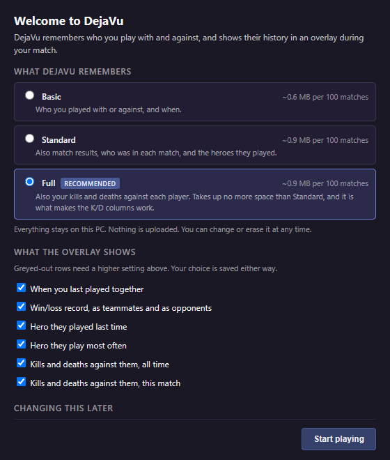
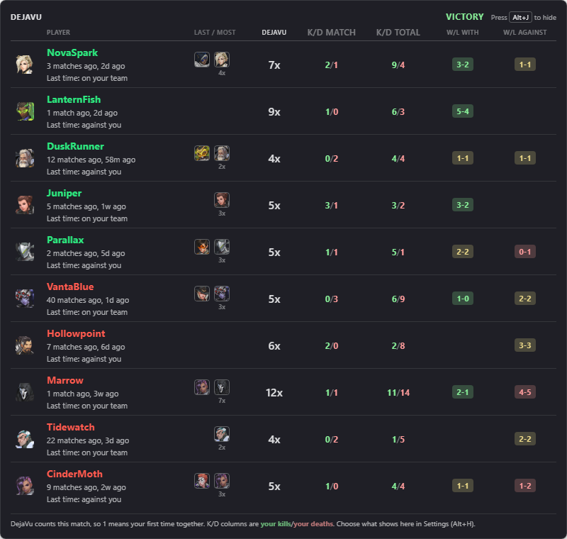
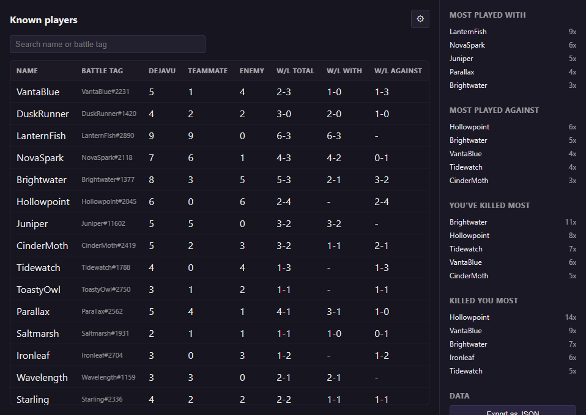
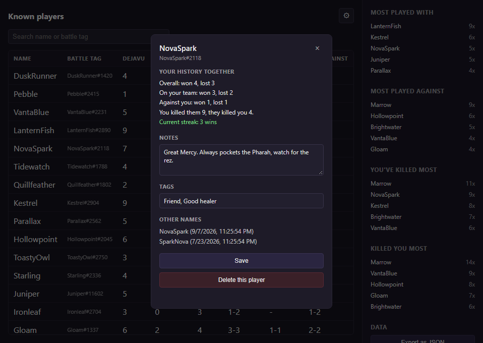
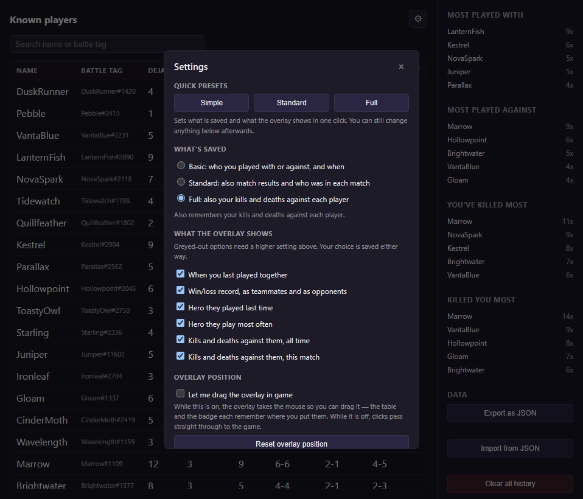

# Overwolf submission — DejaVu - OW (v0.4.0)

## A short summary of your app's purpose

DejaVu remembers the players you meet in Overwatch. During a match, an in-game overlay lists everyone in the lobby with your shared history: how many times you've played together, when you last met and on which side, the heroes they played, your win/loss record with and against them, and your kills and deaths against each other. A desktop History window lets you browse every player you've met, add notes and tags, and export or import your data. Everything is stored on your PC. Nothing is uploaded and you don't need an account.

## Is the app intended for private/public use?

Public

## Which framework is your app developed on?

Overwolf Native (Overwolf WebApp: HTML/JS, manifest_version 1)

## Which games does your app support?

Overwatch 2 (Overwolf game ID 10844)

## Are any of those games developed by Riot

No. Overwatch 2 is developed by Blizzard Entertainment.

## Please link your Discord username

TODO

## If your app has a Discord channel, please share the invite link (make sure the Expiration is set to "Never")

TODO, or leave blank

## Please link your Overwolf account's Email

martintrasak@gmail.com  <!-- confirm this is the email on the Overwolf dev account -->

## Instructions for each window/tab

> Paste the block below into the text field. It is under the 2000-character limit.

```text
DejaVu has 3 windows (Onboarding, Overlay, History) and a background page. There are NO ads or ad containers anywhere in the app.

1) ONBOARDING (onboarding.png)
Opens automatically the first time Overwatch starts with the app running. Pick what DejaVu saves (Basic/Standard/Full) and which overlay columns to show, then click "Start playing". It comes back on each game launch until "Start playing" is clicked.

2) IN-GAME OVERLAY (overlay.png)
In game, a small badge in the bottom-right corner shows the Alt+J hotkey. When a match starts (e.g. Quick Play), the overlay opens as a table of every player in the lobby: times met (DEJAVU column), when you last played and on which side, last and most-played hero, your kills/deaths against them this match and all time, and W/L with and against them. Alt+J switches between the table and the badge. In your first match everyone shows 1x. Play a second match to see repeat players. Clicks pass through to the game unless dragging is turned on in Settings.

3) HISTORY (history.png)
Press Alt+H in game, or launch the app from the Overwolf dock/library on desktop. It lists every known player. You can search, and click a column header to sort. The side panel shows most played with/against, killed most and killed you most. The Data section has Export as JSON, Import from JSON and Clear all history.

3a) PLAYER DETAILS (player-notes.png)
Click any player row in History. It shows your history together, notes and tags you can edit (they appear in the overlay from the next match), and previous names, with Save and "Delete this player" buttons.

3b) SETTINGS (settings.png)
Click the gear icon at the top of History. It has presets, what is saved, which overlay columns are shown, "Let me drag the overlay in game" and Reset overlay position, backups (Back up now / Open backup folder) and the current hotkeys.
```

## Screenshots matching the instructions

Upload these from `docs/assets/`:

| # | File | Matches section |
|---|------|-----------------|
| 1 | [onboarding.png](../docs/assets/onboarding.png) | 1) Onboarding |
| 2 | [overlay.png](../docs/assets/overlay.png) | 2) In-game overlay (expanded table) |
| 3 | [history.png](../docs/assets/history.png) | 3) History |
| 4 | [player-notes.png](../docs/assets/player-notes.png) | 3a) Player details |
| 5 | [settings.png](../docs/assets/settings.png) | 3b) Settings |






